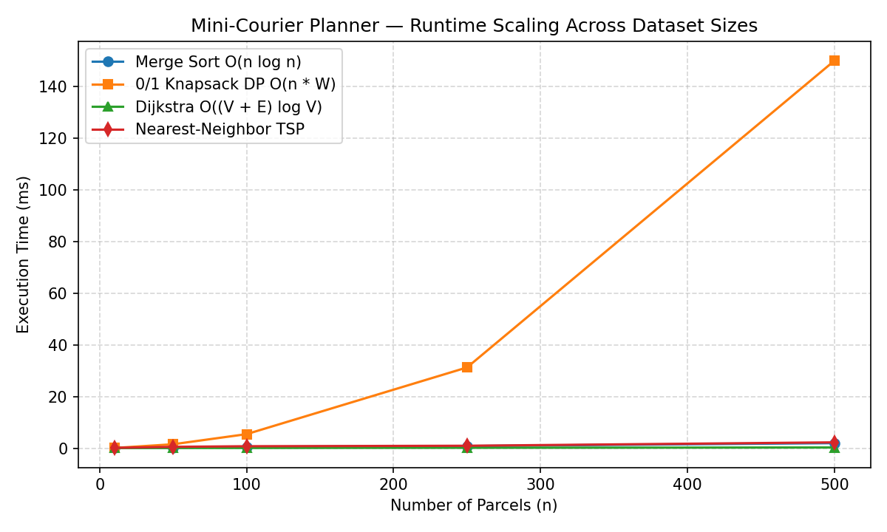

# Capstone Assignment: Mini-Courier Planner

| Field | Details |
| :--- | :--- |
| **Course Title & Code** | Design & Analysis of Algorithms (`ETCCDA302`) |
| **CO Mapping** | `CO1`, `CO2`, `CO3`, `CO4` (`L5: Create/Evaluate`) |
| **Programme** | B.Tech CSE & Specializations |
| **Faculty** | Dr. Shweta Agarwal |
| **Student Name** | Harsh Dev Jha |
| **Roll Number** | `2501010168` |
| **Submission Mode** | Zosima / GitHub Repository |

An integrated Python application simulating an intelligent courier planning system using **Merge Sort**, **0/1 Knapsack Dynamic Programming**, **Dijkstra's Shortest Path Algorithm**, and **Nearest-Neighbor TSP Approximation**.

---

## Rubric Coverage & Evidence Matrix (100 Marks)

| Phase | Title | Marks | Implementation | Verification & Evidence |
| :--- | :--- | :---: | :--- | :--- |
| **Phase 1** | Courier Problem Design and Planning | 20 | [src/models.py](src/models.py) | `Parcel` attributes, `DeliveryGraph` adjacency list, pipeline & algorithm selection below |
| **Phase 2** | Package Prioritization and Box Filling | 20 | [src/sorting.py](src/sorting.py), [src/knapsack.py](src/knapsack.py) | Merge Sort output, full `dp[i][w]` table, backtracked packing plan (`170` value, `15/15 kg`) |
| **Phase 3** | Route Maker and Graph Processing | 20 | [src/routing.py](src/routing.py) | Dijkstra shortest paths from `Depot`, Nearest-Neighbor TSP tour (`26 km`), leg breakdown |
| **Phase 4** | Performance Testing and Optimization | 20 | [src/benchmark.py](src/benchmark.py), [tests/test_planner.py](tests/test_planner.py) | `6/6` passing unit tests, `n=10..500` benchmarks, [runtime_chart.png](outputs/runtime_chart.png), optimization notes |
| **Phase 5** | Final Report and Demonstration | 20 | [main.py](main.py), [readme.md](readme.md) | Reproducible CLI, saved trace [sample_run_output.txt](outputs/sample_run_output.txt), documentation |

---

## Phase 1 — Courier Problem Design & Planning

- **Parcel Model (`src/models.py`)**: Each parcel stores `parcel_id`, `destination`, `weight` (kg), `value`, `deadline` (hours), and `priority` (`1`–`5`).
- **Graph Model (`src/models.py`)**: `DeliveryGraph` stores a weighted undirected road network as an adjacency list `{node: [(neighbor, distance_km), ...]}`.
- **Algorithm Selection & Pipeline**:
  ```text
  Raw Parcels ─▶ Merge Sort (O(n log n)) ─▶ 0/1 Knapsack DP (O(n·W)) ─▶ Selected Stops ─▶ Dijkstra + NN-TSP ─▶ Delivery Tour
  ```
  - **Merge Sort** guarantees stable `O(n log n)` worst-case ordering by urgency without Quick Sort's `O(n²)` worst case.
  - **0/1 Knapsack DP** guarantees the exact optimal subset within vehicle weight capacity `W`.
  - **Dijkstra + Nearest-Neighbor TSP** computes exact shortest road paths between hubs (`O((V + E) log V)`) and constructs a practical tour in polynomial time (`O(k²)` over selected stops).

---

## Phase 2 — Package Prioritization & Box Filling

Running `python main.py` on [data/small_dataset.json](data/small_dataset.json) (`7` parcels, `15 kg` capacity):

### 2A. Prioritized Parcels (Merge Sort)
Sorted by `(deadline ASC, priority DESC, value DESC)`:

| ID | Destination | Weight (kg) | Value | Deadline (h) | Priority |
| :--- | :--- | :---: | :---: | :---: | :---: |
| `P105` | `SectorE` | 2 | 20 | 1 | 4 |
| `P101` | `SectorA` | 4 | 40 | 2 | 5 |
| `P103` | `SectorB` | 3 | 25 | 2 | 3 |
| `P107` | `SectorE` | 5 | 60 | 3 | 5 |
| `P102` | `SectorC` | 5 | 55 | 3 | 4 |
| `P104` | `SectorD` | 6 | 70 | 4 | 5 |
| `P106` | `SectorC` | 4 | 35 | 5 | 2 |

### 2B. 0/1 Knapsack DP Table & Packing Plan
```text
DP Table (rows = items 0..7, cols = capacity 0..15):
  i=0:   0   0   0   0   0   0   0   0   0   0   0   0   0   0   0   0
  i=1:   0   0  20  20  20  20  20  20  20  20  20  20  20  20  20  20
  i=2:   0   0  20  20  40  40  60  60  60  60  60  60  60  60  60  60
  i=3:   0   0  20  25  40  45  60  65  65  85  85  85  85  85  85  85
  i=4:   0   0  20  25  40  60  60  80  85 100 105 120 125 125 145 145
  i=5:   0   0  20  25  40  60  60  80  85 100 115 120 135 140 155 160
  i=6:   0   0  20  25  40  60  70  80  90 100 115 130 135 150 155 170
  i=7:   0   0  20  25  40  60  70  80  90 100 115 130 135 150 155 170
```

- **Selected Parcels (3/7):** `P101` (`SectorA`, `4 kg`, val `40`), `P107` (`SectorE`, `5 kg`, val `60`), `P104` (`SectorD`, `6 kg`, val `70`)
- **Total Weight:** `15 / 15 kg` | **Maximum Value:** `170`

---

## Phase 3 — Route Maker & Graph Processing

### 3A. Dijkstra Shortest Paths from `Depot`
| Destination | Distance (km) | Shortest Path |
| :--- | :---: | :--- |
| `SectorA` | 4 | `Depot -> SectorA` |
| `SectorB` | 6 | `Depot -> SectorA -> SectorB` |
| `SectorC` | 9 | `Depot -> SectorA -> SectorC` |
| `SectorD` | 9 | `Depot -> SectorA -> SectorB -> SectorD` |
| `SectorE` | 13 | `Depot -> SectorA -> SectorB -> SectorD -> SectorE` |

### 3B. Nearest-Neighbor TSP Delivery Route
- **Final Tour:** `Depot -> SectorA -> SectorD -> SectorE -> Depot`
- **Total Route Length:** `26 km`
  - `Depot -> SectorA` (`4 km`): `Depot -> SectorA`
  - `SectorA -> SectorD` (`5 km`): `SectorA -> SectorB -> SectorD`
  - `SectorD -> SectorE` (`4 km`): `SectorD -> SectorE`
  - `SectorE -> Depot` (`13 km`): `SectorE -> SectorD -> SectorB -> SectorA -> Depot`

---

## Phase 4 — Performance Testing & Optimization

### Complexity Analysis
| Component | Algorithm | Time Complexity | Space Complexity |
| :--- | :--- | :--- | :--- |
| Parcel Prioritization | Merge Sort | `O(n log n)` | `O(n)` |
| Box Filling | 0/1 Knapsack DP | `O(n * W)` | `O(n * W)` |
| Shortest Paths | Dijkstra (Binary Heap) | `O((V + E) log V)` | `O(V)` |
| Delivery Tour | Nearest-Neighbor TSP | `O(k * (V + E) log V + k²)` | `O(k * V)` |

### Recorded Runtime Scaling (`outputs/benchmark_results.json`)
| Parcels (`n`) | Nodes (`V`) | Capacity (`W`) | Merge Sort (ms) | Knapsack DP (ms) | Dijkstra (ms) | Nearest-Neighbor TSP (ms) |
| :---: | :---: | :---: | :---: | :---: | :---: | :---: |
| 10 | 8 | 20 | 0.0425 | 0.0743 | 0.0465 | 0.1297 |
| 50 | 15 | 100 | 0.2066 | 1.5105 | 0.0714 | 0.5071 |
| 100 | 25 | 200 | 0.4985 | 5.4242 | 0.0735 | 0.7429 |
| 250 | 40 | 500 | 0.8238 | 31.2254 | 0.1462 | 0.9260 |
| 500 | 60 | 1000 | 1.9469 | 149.9062 | 0.2546 | 2.2458 |



### Unit Tests & Correctness Evidence (`tests/test_planner.py`)
`python -m unittest discover -s tests -p "test_*.py" -v` — **6/6 tests passed**:
- `test_merge_sort_orders_by_deadline_then_priority`
- `test_knapsack_selects_optimal_value`
- `test_knapsack_zero_capacity`
- `test_dijkstra_shortest_path`
- `test_nearest_neighbor_tsp_returns_to_depot`
- `test_unreachable_stop_raises`

### Future Optimization Suggestions
1. **1D Space-Optimized Knapsack DP**: When only the optimal value is needed, a 1D `dp[W+1]` array reduces space from `O(n * W)` to `O(W)`.
2. **2-Opt Local Search on TSP Tour**: Applying a `2-opt` swap pass after Nearest-Neighbor eliminates crossing route segments for tighter tour lengths.
3. **All-Pairs Precomputation**: Caching hub-to-hub distances once across multiple trips avoids repeating Dijkstra per dispatch.

---

## Phase 5 — Execution Steps & Repository Layout

```text
DAA-Capstone/
├── data/
│   ├── small_dataset.json        # 7 parcels, 6 hubs, 15 kg capacity
│   └── large_dataset.json        # 15 parcels, 10 hubs, 45 kg capacity
├── outputs/
│   ├── benchmark_results.json    # Benchmark timings (n = 10..500)
│   ├── runtime_chart.png         # Runtime scaling plot
│   └── sample_run_output.txt     # Full execution trace
├── src/
│   ├── models.py                 # Parcel & DeliveryGraph
│   ├── sorting.py                # Merge Sort
│   ├── knapsack.py               # 0/1 Knapsack DP
│   ├── routing.py                # Dijkstra & Nearest-Neighbor TSP
│   └── benchmark.py              # Performance benchmark & chart script
├── tests/
│   └── test_planner.py           # Unit tests
├── main.py                       # CLI entry point
└── readme.md
```

**Run Demo (Small & Large Datasets):**
```bash
python main.py
python main.py data/large_dataset.json
```

**Run Unit Tests & Benchmarks:**
```bash
python -m unittest discover -s tests -p "test_*.py" -v
python -m src.benchmark
```
